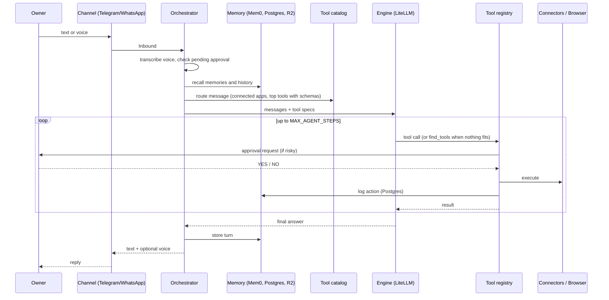
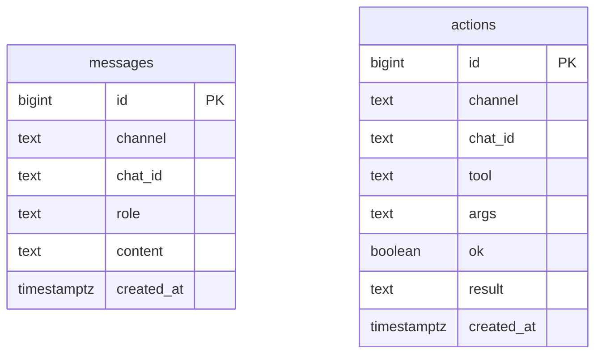

# Architecture

## Request flow

## Components

| Module | Responsibility |
| --- | --- |
| `config.py` | Single source of truth for settings |
| `main.py` | Daemon wiring and CLI |
| `channels/telegram.py` | Telegram polling channel |
| `channels/whatsapp.py` | WhatsApp webhook channel |
| `orchestrator.py` | Per-message pipeline |
| `engine.py` | Async tool-calling loop over LiteLLM `acompletion` |
| `tools.py` | Tool registry, approval gate, action logging |
| `approvals.py` | YES/NO approval broker |
| `catalog.py` | Intent routing, BM25 tool ranking, schema cleanup, `find_tools` |
| `connectors.py` | Composio provider and the generic Nango proxy tool |
| `nango_tools.py` | Curated Nango tools (GitHub, Gmail, Google Calendar, Slack) |
| `browser.py` | Playwright session manager and browser tools |
| `memory.py` | Postgres, Mem0 and R2 stores |
| `voice.py` | Transcription and ElevenLabs synthesis |

## Design decisions

* Hermes and OpenClaw are reached as OpenAI-compatible endpoints through LiteLLM, so one code path serves every engine.
* Structured platforms go through connectors (Composio, Nango). Only apps without usable APIs go through the browser.
* The model does not explore tools inside its loop. The catalog narrows first (connected apps, then message intent,
  then the top tools) and injects them with full schemas, so common requests finish in about two steps.
* `find_tools` is the single fallback. Its matches are added to the request's tool set and are callable on the next step.
* Composio provides its own tool catalog, which is cached per toolkit. Nango has none, so tools are curated in code.
* The browser can only visit allowlisted domains and re-checks the final URL after redirects.
* Outbound or irreversible actions pass through the approval broker before the handler runs.
* A per-chat lock serializes turns. Approval replies bypass the lock so they can resolve a waiting tool call.
* Memory failures degrade gracefully and never block a reply.

## Data model

